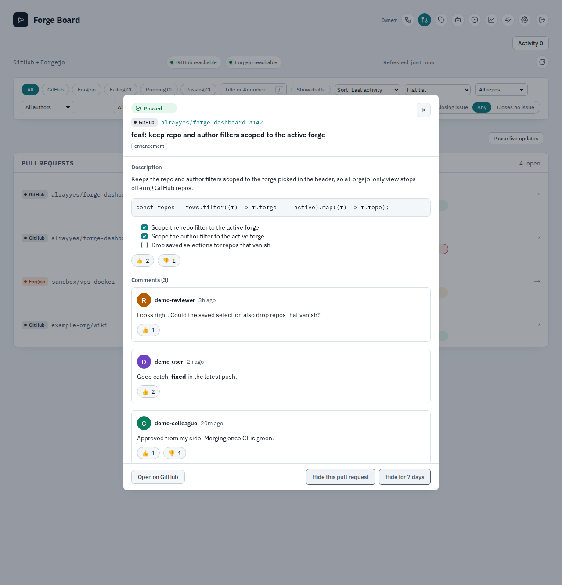
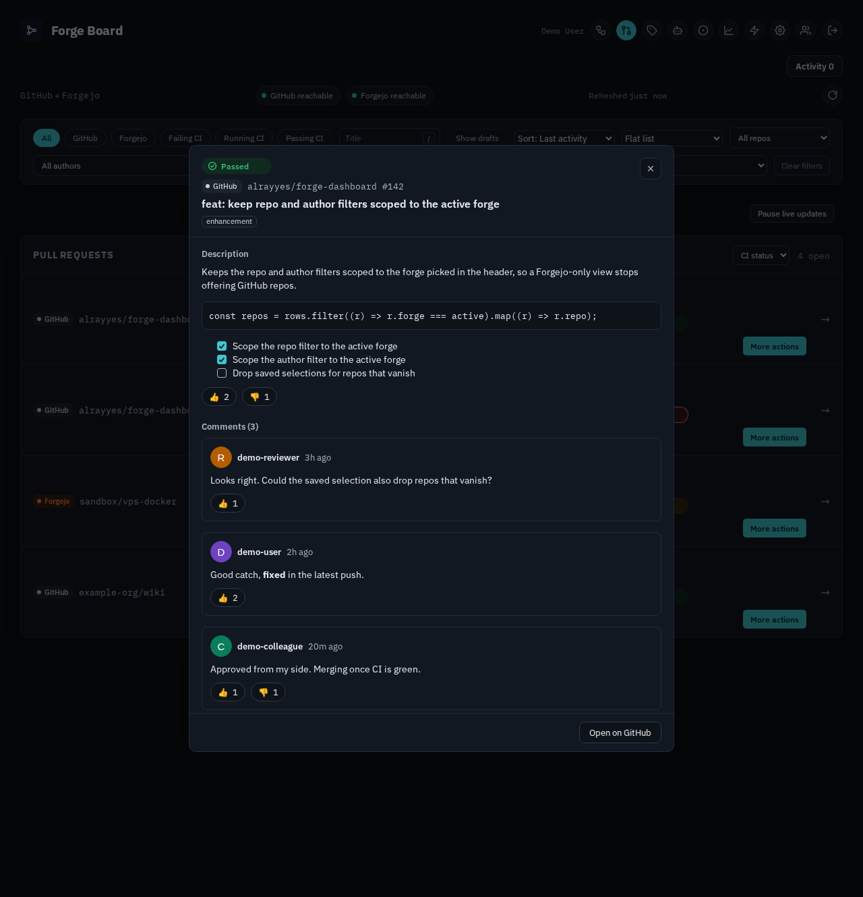
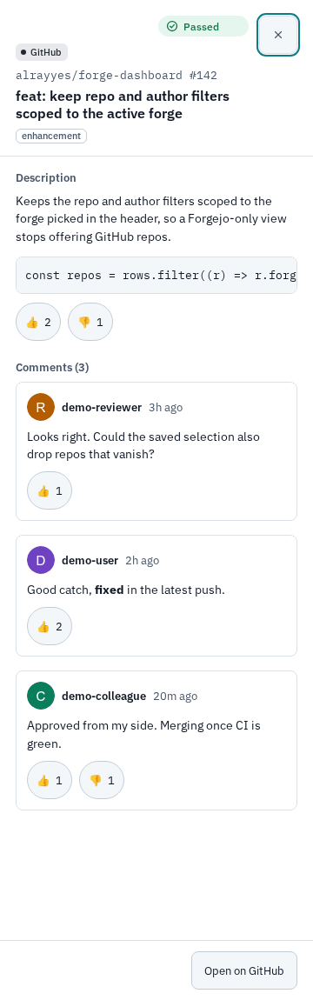
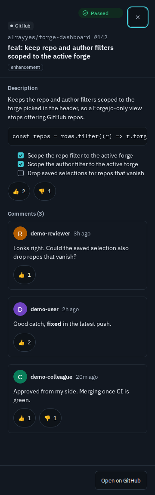
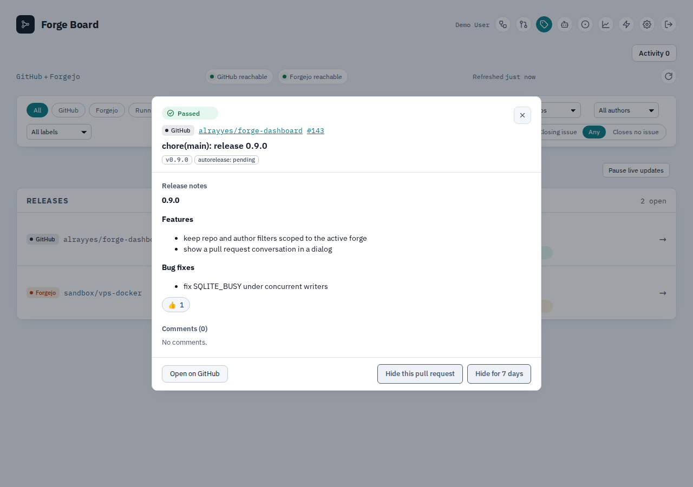
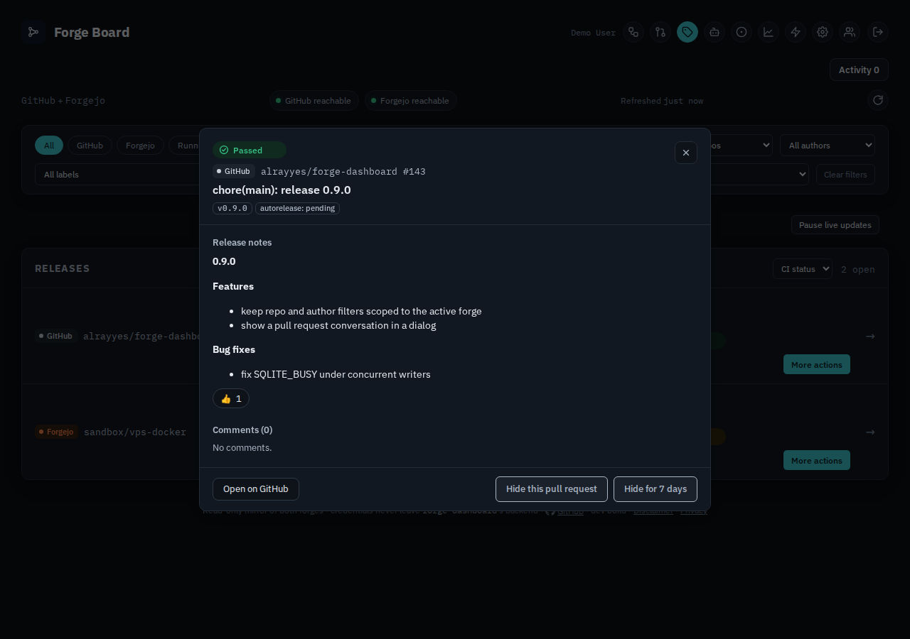
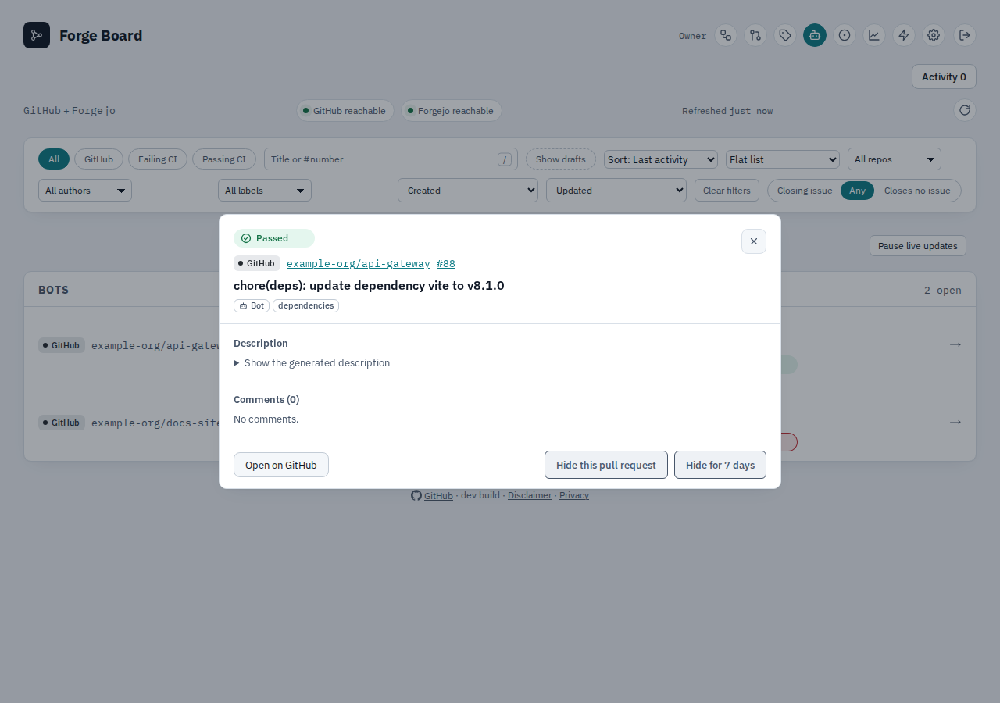
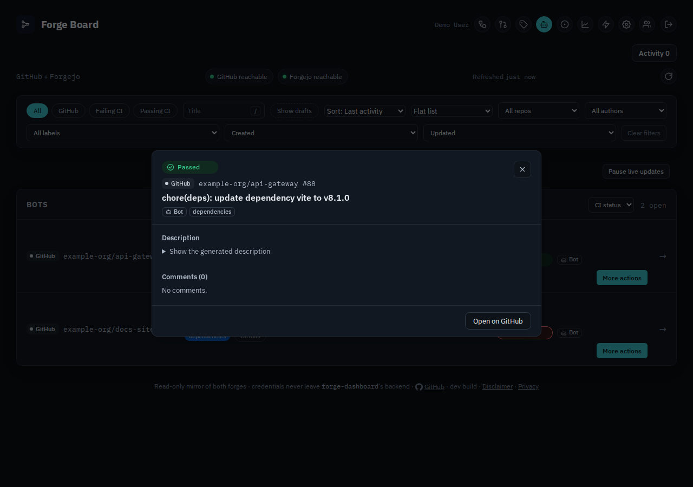

# forge-dashboard

[](https://github.com/alrayyes/forge-dashboard/actions/workflows/ci.yml)
[](https://github.com/alrayyes/forge-dashboard/releases/latest)
[](LICENSE)
[](https://codecov.io/gh/alrayyes/forge-dashboard)
[](https://pkg.go.dev/github.com/alrayyes/forge-dashboard)

A dashboard of open pull requests, issues, and CI status across
every repository you have write access to on **GitHub** and a **Forgejo**
instance — one page instead of two forge UIs. It has passwordless login
and settings-managed tokens.

## Quick start

Generate the encryption key once and keep it somewhere safe, such as a password
manager. It needs `openssl`; any base64-encoded 32 random bytes work too.

```sh
export ENCRYPTION_KEY="$(openssl rand -base64 32)"
docker run --rm -p 8080:8080 -v forge-dashboard-data:/data \
  -e RP_ID=localhost -e RP_ORIGIN=http://localhost:8080 \
  -e ENCRYPTION_KEY \
  ghcr.io/alrayyes/forge-dashboard:latest
```

Open <http://localhost:8080>, register a passkey, then add your GitHub and
Forgejo credentials from Settings. On the next run, export the same key again:
a new one can't decrypt the credentials saved in the volume. The full command
with hardening flags, building from source and the health check are in
[Running it](docs/running.md).

`RP_ID` and `RP_ORIGIN` default to `localhost` and `http://localhost:8080`. For
any other deployment, set them to your real domain and its `https://` origin;
see [Configuration](docs/configuration.md).

| Page                                                                                                                                                                                                                                                                     | Light                                                                               | Dark                                                                              |
| ------------------------------------------------------------------------------------------------------------------------------------------------------------------------------------------------------------------------------------------------------------------------ | ----------------------------------------------------------------------------------- | --------------------------------------------------------------------------------- |
| **Branches**. The CI status of every default branch, latest commit first.                                                                                                                                                                                                |                         |                         |
| **Pull requests**. Open pull requests across both forges, with CI status, filters, sorting, and an update-all action.                                                                                                                                                    |               |               |
| **Pull request details**. A pull request's description, comments, and thumbs reactions.                                                                                                                                                                                  |  |  |
| **Phone sheet**. The same details on a 360px screen.                                                                                                                                                                                                                     |            |            |
| **Pipeline checks**. A pull request's checks with state, time, failure excerpt, a Copy log button for the whole log of a failed or timed-out check, each run's output with a Copy button, and Rerun failed checks or Cancel run behind a confirm step, from its CI pill. |           |           |
| **Issues**. Open issues across both forges. Close one from its dialog, with or without a comment.                                                                                                                                                                        |                             |                             |
| **Releases**. Release pull requests waiting to ship.                                                                                                                                                                                                                     |                         |                         |
| **Release details**. The release notes a release pull request publishes.                                                                                                                                                                                                 |            |            |
| **Bots**. Dependabot and Renovate pull requests, with a rebase-all action.                                                                                                                                                                                               |                                 |                                 |
| **Bot details**. A bot pull request, its generated text collapsed.                                                                                                                                                                                                       |                    |                    |
| **Insights**. Charts of CI state and the busiest repos.                                                                                                                                                                                                                  |                         |                         |
| **Webhooks**. Which tracked repos have a confirmed webhook, and a way to add one.                                                                                                                                                                                        |                         |                         |
| **Settings**. Four groups, one at a time: display, connections, behaviour, integrations and security.                                                                                                                                                                    |                         |                         |
| **Login**. Passkey sign-in.                                                                                                                                                                                                                                              |                               |                               |

Fixture data, not a real account's actual repositories. The release
workflow regenerates every screenshot on each release (see
`scripts/capture-screenshots.ts`), so they're never more than one release
stale.

## Requirements

- **Go 1.27 or newer**, to build.
- **[bun](https://bun.sh)**, to build from source — `bun run build:web`
  has to run before `go build` picks up its output (see
  [Architecture](ARCHITECTURE.md#design)). Not needed to run a pre-built release
  binary or the Docker image, both of which already have that step baked in.
- **A passkey-capable browser** to sign in at all — any current Chrome,
  Safari, Firefox or Edge; a phone counts too. Nothing else to install.
- **Somewhere writable for the database** (`DB_PATH`, default
  `/data/forge-dashboard.db`) that survives a restart — registered
  passkeys, sessions, and the owner's encrypted forge credentials live
  there. In Docker that means a mounted volume at `/data`; see
  [Docker](docs/running.md#docker).
- **`ENCRYPTION_KEY`**, a base64-encoded 32-byte key the process refuses
  to start without — see [Configuration](docs/configuration.md) for how to
  generate one.
  It's what encrypts the forge tokens at rest; there's no
  sensible default for a secret like this one.
- You configure your forge credentials from the
  Settings page after registering — see
  [Credentials](docs/accounts.md#credentials) for exactly which permissions to
  grant. Nothing forge-related needs setting before
  the process starts.
- **Optional: advisories.** Read-only access is enough. A GitHub credential
  reads Dependabot alerts with **Dependabot alerts: Read-only** (or the classic
  `security_events` scope), and so does a GitHub App with the same permission.
  Alerts must also be switched on for the repo. Without access the page shows
  advisories as unknown, not zero; a rate limit or a GitHub error does the same.
  Answers are cached for fifteen minutes, so a fix can take that long to show,
  and longer for a GitHub App. See
  [When advisories can't be read](docs/main-branches.md#when-advisories-cant-be-read).
  Forgejo has no alerts of its own. Its advisories come from the repo's lock
  files, matched against [OSV](https://osv.dev), and only if you switch that on:
  see [Privacy](#privacy). If OSV can't be reached or a lock file can't be
  read, the Branches page says so instead of showing nothing. When some
  packages were left out for not being public, the count reads "at least".

## Privacy

The dashboard talks to your forges and to nothing else, with one opt-in
exception. Forgejo has no dependency alerts, so the dashboard can match a
repo's lock files against the public [OSV](https://osv.dev) database instead.
That is off by default. Set `OSV_ADVISORIES=on` to turn it on.

When it is on, **the package names and versions in each Forgejo repo's lock
files, in the root or any subdirectory (`package-lock.json`, `bun.lock`,
`composer.lock`, `poetry.lock`, `uv.lock`, `Cargo.lock` and `go.mod`) are sent
to `api.osv.dev`**, private repos included. Only some things are kept out: Go
modules on the Forgejo host itself, and packages that a lock file shows don't
come from the public registry of their ecosystem (Composer's doesn't say, so its
packages are all sent). A private Go module on another host, or a private scoped
package on the public npm registry, is still sent by name, which is why this is
off by default, so think before enabling it on a server that holds private
repos. Nothing else is sent: no repo name, URL or token. The dashboard logs a
line at startup when it is on, and a warning when the value is neither `on` nor
`off`, which leaves it off. While it is off, Forgejo rows say the repo was not
checked. GitHub repos are not affected: they read Dependabot alerts from GitHub.
See [Main branches](docs/main-branches.md#forgejo-advisories).

## Documentation

- [Pull request actions](docs/pull-request-actions.md): what a row offers, and
  why a blocked action is blocked.
- [Pull request pages](docs/pull-request-pages.md): the details pop-up, the
  Releases and Bots pages and hiding one pull request.
- [Issues](docs/issues.md): the issues page and the settings that hide issues.
- [Main branches](docs/main-branches.md): the default-branch CI page and
  `GET /api/v1/main-branches`.
- [Live updates and filters](docs/live-updates.md): how the board refreshes, when
  rows wait before they land, the first load after a restart, the
  navigation counts, and how filters are offered, remembered and folded on a
  phone.
- [API](docs/api.md): the HTTP endpoints, the OpenAPI contract and the MCP
  endpoint.
- [Rate limits](docs/rate-limits.md): why a forge is rate limited, what the
  dashboard does meanwhile, and what to change.
- [Accounts](docs/accounts.md): passkey login, API tokens
  and the GitHub and Forgejo credentials.
- [Configuration](docs/configuration.md): every environment variable, how repositories
  are discovered and the GitHub App option.
- [Running it](docs/running.md): building and starting the app, and running the
  Docker image with its health check.
- [Deployment](docs/deployment.md): where the project's own instance runs.
- [The changelog page](docs/changelog-page.md): the page the footer version
  links to.
- [Webhooks](docs/webhooks.md): registering the forge webhook and the checks the
  dashboard runs on its own.
- [Error pages](docs/error-pages.md): the app's own 404 and 500 pages and what they
  show.
- [Reports](docs/reports.md): the test, coverage and Lighthouse reports published
  after every green push to `main`.
- [Architecture](ARCHITECTURE.md#design): the design choices behind the app, from
  passkey login to the MCP endpoint and the single binary.

## Contributing

See [CONTRIBUTING.md](CONTRIBUTING.md) for the toolchain, the hooks, and
how a change gets reviewed and released. [ARCHITECTURE.md](ARCHITECTURE.md)
is the one-page map of how the pieces fit, and
[the decision records](docs/adr/) record why the big choices went the way
they did.

## Licence

[AGPL-3.0](LICENSE). Chosen over the plain GPL-3.0 this project started
under because AGPL's network-use clause also covers running a modified
copy as a hosted service, which GPL alone doesn't.

### Fonts

The app serves its own fonts, so a page never contacts another host to render
text. IBM Plex Sans (400, 500, 600, 700) and IBM Plex Mono (400, 500, 600) come
from the pinned `@fontsource/ibm-plex-sans` and `@fontsource/ibm-plex-mono`
packages, bundled by the web build in the Latin and Latin Extended subsets, with
`font-display: swap`. IBM Plex is released under
[OFL-1.1](https://openfontlicense.org/), the SIL open font licence, which allows
bundling and redistribution with this app.
