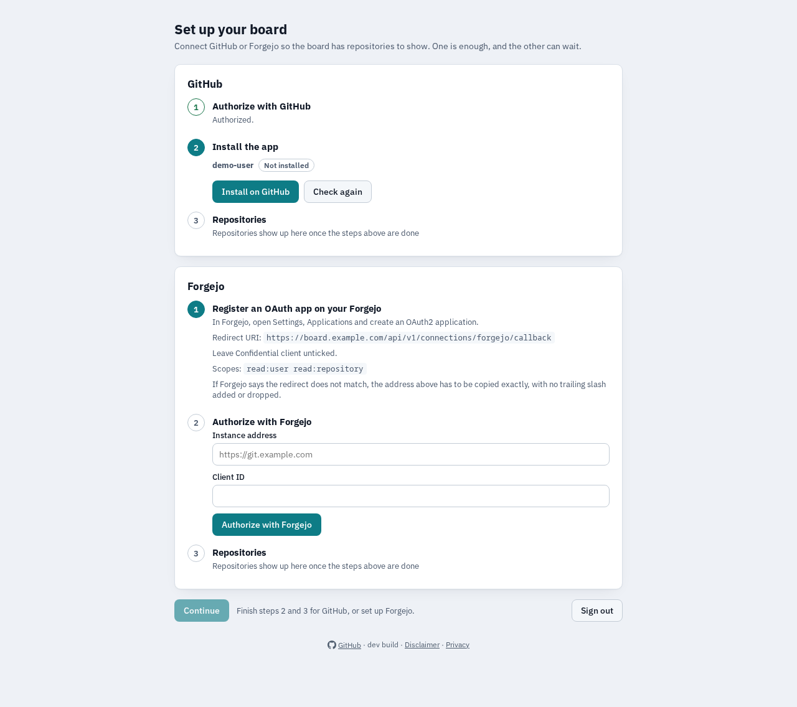

# Accounts

Signing in, API tokens, and the forge
credentials each account saves.

## Authentication

Forge Dashboard is an internal tool, not a public site, so it keeps out of
search engines. Every response carries `X-Robots-Tag: noindex, nofollow`, the
HTML shell has a matching `<meta name="robots">` tag, and `robots.txt` allows
crawling on purpose: a crawler that can't fetch a page never reads its
`noindex`. The real barrier is the passkey login below.

Every response also carries `Content-Security-Policy: img-src 'self'`.
Avatars, repository logos and images in descriptions all come through this
server, so your browser refuses to load an image from anywhere else.

A Forgejo avatar on any host but your saved instance (Gravatar and Libravatar
included) is refused, and the author shows an initial. Settings says so inside
the Forgejo card: an amber note, "Avatars from another host were skipped:
`host`. Initials are shown instead.", with every skipped host listed in
a code font (up to eight, "other hosts" when there are several), never one line
per avatar. The server remembers a host while its avatars keep being asked for
and forgets it about ten minutes after the last one, so the note clears on its
own once nothing is skipped. A restart clears it too. It's in
`forgejoSkippedAvatarHosts` on `GET /api/v1/settings`.

The first visit registers a passkey and becomes the instance's only user —
no password anywhere, and no separate account system. Neither registering nor
signing in asks for a username: the server names the account, and the sign-in
button starts the passkey prompt straight away. The sign-in names no passkey,
so the browser offers whichever one it has saved for the site, and every new
passkey is registered as a discoverable one (a resident key) for that reason.
A passkey from a password manager or a phone is already discoverable, and one
registered back when a username was asked for keeps working. `POST
/api/v1/auth/register/begin` and `.../finish` run the WebAuthn registration
ceremony, `.../login/begin`/`.../finish` run the login ceremony, and a
signed session cookie (`HttpOnly`, `SameSite=Lax`, `Secure` whenever the
request arrived over HTTPS) is what actually gates `/` and
`/api/v1/dashboard` afterward — see `internal/auth` and `api/openapi.yaml`'s
`auth` tag.

- **Registration closes for good once a passkey exists.** No environment
  variable to set or get wrong, and no reliance on a deployment's own
  network boundary either: `Service.BeginRegistration` checks server-side
  whether any user already holds a passkey and answers 403
  `registration is closed` if so. The login page only shows the registration
  button on an instance with no users. More passkeys for the same account are
  added from Settings, signed in.
- **Passkeys can be renamed.** Settings lists each passkey by name, with a
  Rename button next to Remove, so a password manager and a security key can
  be told apart. A name is trimmed and 1 to 64 characters, whether it is
  given when adding a passkey or when renaming one, and is always shown as
  plain text. A passkey that never had a name is listed by the date it was
  added. For one with no stored record at all, from before names existed,
  that date is the account's creation time. The API route is
  `PATCH /api/v1/auth/credentials/{id}`.
- **A security key may hold a passkey that sign-in can't use.** Registered
  before sign-in dropped the username, a key such as a YubiKey stored a
  credential that isn't discoverable, which the browser can't offer without
  being told its ID. Sign in on a device with a saved passkey, then add the
  key again from Settings: it is now registered as a discoverable passkey.
  If the old key was the only passkey, no device offers one, and the way back
  in is `forge-dashboard reset-passkeys` below.
  The login page points to this after a second failed prompt in a row, since
  the browser reports a cancelled prompt and a missing passkey the same way.
- **Losing every passkey is fixed from the host, not the browser.** There's
  no email or SMS channel here to build a self-service recovery flow on, so
  the operator runs `forge-dashboard reset-passkeys`, which clears the
  owner's passkeys and reopens registration. Settings and the webhook token
  are kept. See [Lost your only passkey](running.md#lost-your-only-passkey).
- **`RP_ID`** / **`RP_ORIGIN`** configure the WebAuthn relying party.
  They default to `localhost` / `http://localhost:8080` for a local run;
  a real deployment **must** set both to its real domain, or every
  passkey registered against the default refuses to work there — a
  passkey is cryptographically bound to the origin it was created for,
  not something this service can paper over after the fact.

### Rate limit

The sign-in and registration endpoints take requests from anyone, and each
`begin` call parks a ceremony on the server for five minutes. So they are
limited per client address: `POST /api/v1/auth/register/begin`, `.../finish`,
`login/begin` and `.../finish` share one allowance of 10 requests at once, then
one more every 6 seconds. Past it the server answers `429` with a `Retry-After`
header in seconds, and the login page says to wait that long. Signing in takes
two requests, so the owner never reaches it. Over five minutes one address can
make at most 60 requests, fewer than the 100 pending ceremonies the server
holds, so a scanner can't push the owner's sign-in out.

The limit is on the address, not the account: sign-in names no user, and a
limit per account would let a stranger lock the owner out. The address is the
connection's own. Behind a reverse proxy that is the proxy, so the service reads
the client from the proxy's `X-Forwarded-For` instead, from the right end,
skipping every address listed in `TRUSTED_PROXIES` (see
[Configuration](configuration.md)). It believes that header only from those
proxies, and only the entries they wrote. An IPv6 client counts by its /64.

The proxy must forward the client's address in `X-Forwarded-For`. Most do by
default; some need a setting that adds the header. When a trusted proxy sends
none (or only addresses of trusted proxies), nothing tells the visitors apart.
Those requests then share one bucket, twice the size of a single address's
(20 at once, then one every 6 seconds), and are refused with `429` and
`Retry-After` like any other. Over five minutes that is at most 70 requests,
fewer than the 100 pending ceremonies, so this bucket alone can't fill the
store. It can be used up, though, and then the owner gets `429` for a while.
One address that does forward adds up to 60 more in the same five minutes, so
the shared bucket and such addresses together can exceed 100, as two addresses
always could. The server logs a warning once, naming the peer.

Running `docker run -p 8080:8080` with the default settings is this case: the
container sees the Docker gateway address, which is in the default trusted
ranges, and no `X-Forwarded-For`. Every visitor shares the one bucket. To get
a limit per address, put a proxy that forwards the client address in front. If
the service is reached with no proxy and the real client address does reach it,
set `TRUSTED_PROXIES=none` so each visitor counts by its own address. Behind
published Docker ports the real address is often lost, and then there is one
shared bucket either way.

Account lockout and CAPTCHA are not part of this.

### API tokens

A script can authenticate the same way a signed-in browser does, without
a WebAuthn ceremony of its own to perform: generate a personal API token
from Settings' "API tokens" card, then send it as a Bearer credential —

```sh
curl -H "Authorization: Bearer fdb_<the-generated-token>" \
  http://localhost:8080/api/v1/dashboard
```

against any endpoint the frontend itself calls, `RequireAuth` accepts
either credential (session cookie or a live token) the same way. The one
exception is the saved filters of the web UI
(`/api/v1/settings/filter-state`): that is the browser's own state, so it
takes a session cookie only and answers a
token with 403. Each save is logged with the user agent, so a filter
that changed by itself can be traced to the client that wrote it. The raw
value is shown exactly once, right after generating it — only its hash
is stored, so losing it means generating a new one, same as any other
bearer credential. Settings lists every live token (label, created date,
last-used date) with a one-click **Revoke** that stops it authenticating
immediately.

#### Use with an AI client

The same token works on the MCP endpoint, so an AI client can read your pull
requests. Settings' "API tokens" card has a "Use with an AI client" section
with the address for the page you are on and a copy button. The address
is your dashboard's own origin plus `/api/v1/mcp`:

```text
https://<your-dashboard-host>/api/v1/mcp
```

The client sends the token as a header on every request, the same one the
`curl` example uses:

```text
Authorization: Bearer <token>
```

Generate the token first (the card shows it once) and keep it out of the
address: it goes in the header only.

- **Claude Code**: run

  ```sh
  claude mcp add --transport http forge-dashboard \
    https://<your-dashboard-host>/api/v1/mcp \
    --header "Authorization: Bearer <token>"
  ```

  Add `--scope user` to use it in every project, not just this one. Check it
  with `claude mcp list` or `/mcp`. Claude Code saves the entry without
  testing the token, so a wrong one shows up there, not when you add it.
  See the [Claude Code MCP docs](https://code.claude.com/docs/en/mcp).

- **Claude on the web and Claude Desktop**: open Customize, then Connectors,
  then Add custom connector, and paste the address. Choose "No sign in",
  since this endpoint uses the token and not OAuth, and put the header under
  "Request headers". Claude connects from the cloud, not from your machine, so the
  dashboard has to be reachable from the internet on port 443. Free plans are
  limited to one custom connector. On Team and Enterprise plans only an
  Owner can add one, under Organization settings, then Connectors, and members
  then connect to it from Customize, then Connectors. See
  [custom connectors using remote MCP](https://support.claude.com/en/articles/11175166).

The endpoint offers these tools:

| Tool                           | What it returns or does                                         |
| ------------------------------ | --------------------------------------------------------------- |
| `get_dashboard`                | Your pull requests, as `GET /api/v1/dashboard`.                 |
| `get_main_branches`            | Default-branch CI status and open dependency advisories.        |
| `get_pull_request_details`     | A pull request's description, its comments, and its reactions.  |
| `get_pull_request_checks`      | A pull request's individual CI checks.                          |
| `get_main_branch_checks`       | The jobs of a default branch's newest pipeline.                 |
| `get_repository_advisories`    | A GitHub repository's open dependency advisories in full.       |
| `get_check_log`                | One CI job's output, the last 256 KiB at most.                  |
| `list_queued_actions`          | Actions waiting on a rate-limited forge, and the recently done. |
| `get_version`                  | The running server's release tag.                               |
| `get_forge_api_stats`          | The forge request counters and budgets.                         |
| `get_settings`                 | Your settings. The webhook token and secret stay out.           |
| `set_pull_request_auto_update` | Turns automatic branch update on or off for one pull request.   |

`set_pull_request_auto_update` is the only one that writes, and it changes
only this app's own setting. Several of the reads spend forge request budget;
[Architecture](../ARCHITECTURE.md#design) has the cost of each.

## First-login setup

A signed-in board with nothing linked sends every page to `/setup`, "Set up
your board". It has one block per forge and one is enough. Continue opens once
a forge has repositories to show, or is still counting them, and Sign out is
always there, even when the page cannot load its details.



- **GitHub**: authorize with GitHub, install the App on your account or an
  organization you belong to, then see the repositories it can reach. If an
  organization owner has to approve the installation, the page shows it as waiting
  for approval until they do. Use **Check again** after any step done on
  GitHub. The installation link needs `GITHUB_APP_SLUG`
  ([configuration](configuration.md)).
- **Forgejo**: register an OAuth app on your own Forgejo (Settings,
  Applications), leave **Confidential client** off, set the redirect URI
  the page shows, then paste the instance address and the app's Client ID. The
  Client ID is public. Nothing on this page takes a token.
- **When it fails**, the page names the cause and says nothing was saved. A
  wrong Client ID or a redirect URI that does not match what the page shows
  are the usual causes on Forgejo: fix the app on Forgejo, then try again.
- **Why the board is not empty on upgrade**: a board that already reads a
  saved token, a username, or an installation is never sent here.

The page reads `GET /api/v1/setup`, which states facts only. Which step is
current and whether Continue is open are worked out in the browser. The
callbacks of both forges land back on `/setup`, with `?error=<code>` after a
failure and `?install=requested` after an installation request.

## Credentials

Set from the Settings page (`/settings.html`, linked from the dashboard
header) once you're signed in — nothing forge-related is configured by
the process itself. The page has five groups (Display, Connections,
Behaviour, Integrations and security, Repositories), one shown at a time; the
group is in the URL hash, so `/settings.html#connections` opens Connections.

Each forge takes either a token (sees private repos
too) or a bare username (public repos only, no credential at all) —
never both purposes at once. A token always wins over a username if you
set both, and leaving a token field blank on save keeps whatever was
saved before, so updating your username doesn't mean re-pasting the
token too.

The server decides whether a save is valid (for example a Forgejo token or username
with no instance URL, or a bad installation ID). A refused save answers 400 with
the reason and the name of the field (`field`), and the page shows that reason
and puts focus on that input. The page holds no copy of those rules.

### GitHub

- **Token**: a personal access token with read access to the
  repositories you want tracked, plus write access to their webhooks if
  you want the dashboard to create its own webhooks, and
  optionally Dependabot alerts (read) for the Branches page's advisories. The
  exact scope, classic and fine-grained, lives in Settings' own
  "What does this token need?" help under the token field — one place, kept
  current with what the
  app actually requests, rather than a second copy here that can drift
  out of sync with it.
- **Username only** (token left blank): shows that account's public
  repositories, fully unauthenticated — the same data anyone gets
  landing on `github.com/<username>?tab=repositories`. Verified live
  against a real 105-public-repo account. GitHub caps unauthenticated API
  calls far lower than token calls (see [Rate limits](rate-limits.md)), so this
  mode only sees everything on an account small enough to fit that budget. A
  token is what a bigger account needs.
- **GitHub App installation** (operator opt-in): if this deployment has
  a GitHub App configured, a field next to the token lets you connect
  an installation instead — its own independent rate-limit budget
  rather than your account's shared one. Setup is in
  [GitHub App support](configuration.md#github-app-support), and
  [Rate limits](rate-limits.md) explains the budgets.
- **Linked account** (operator opt-in): if this deployment has the GitHub
  App's OAuth client configured, you can link your GitHub account
  ([setup](configuration.md#github-account-sign-in)). The user token renews
  itself and is stored encrypted. It is never in `GET /api/v1/settings`, which
  only reports `githubOAuthConfigured` and `githubOAuthConnected`. Disconnect
  removes the link and leaves a saved token and the installation alone. Nothing
  reads through the linked account yet.
  Installations are kept one per row, so a second account or org can be added
  through the App's Setup URL without pasting an ID; the existing installation
  ID is carried over as the first row when you upgrade. Every enabled row is
  read with its own installation token and the results are merged.
  Installation webhooks keep the rows current: an installation removed on
  GitHub drops its row, and a suspended one is skipped until GitHub lifts the suspension.
  A new installation is added from the webhook only when GitHub lists it for
  the linked account, so only installations the owner made or allowed reach the
  board (see [configuration.md](configuration.md)).

### Forgejo

- **Token**: `Settings → Applications → Generate New Token`. Same
  "see Settings' own field hint" pointer the GitHub token entry gives
  — it lists every scope, including `read:user`, easy to miss since it isn't
  obviously related to repos, but `GET /user/repos` (how repository
  discovery works) refuses a token without it: confirmed live against a
  real instance, `403 token does not have at least one of required
scope(s): [read:user]`, before it was added to the token.
- **Linked account** (operator opt-in): if this deployment has a Forgejo
  OAuth client configured, you can link your account instead of pasting a token
  ([setup](configuration.md#forgejo-oauth)). The access token renews itself and
  wins over a pasted token while the account is linked. Disconnect, and the
  pasted token is used again. Tokens are stored encrypted and are never in
  `GET /api/v1/settings`, which only reports `forgejoOAuthConfigured` and
  `forgejoOAuthConnected`. The instance URL is locked while linked. A
  pasted token saved for a different instance is cleared when you link, since
  it was issued for another host.
- **Username only** (token left blank, instance URL still set): shows
  that account's public repositories on the configured instance,
  unauthenticated — same trade-off as GitHub's username mode. Verified
  against a real Forgejo instance's `GET /users/<username>/repos`.
